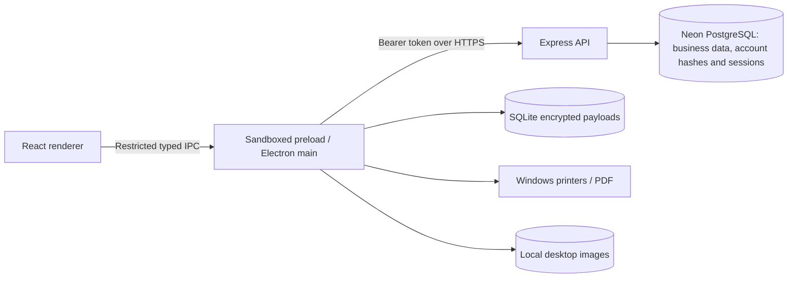

# Architecture

## Runtime boundaries

React handles navigation, forms, tables, charts and client query caching. It has no Node.js, filesystem, raw IPC, database credentials or access-token API. The preload exposes only the functions declared in `packages/shared/src/desktop.ts`.

Electron main validates IPC senders and schemas, stores API sessions using Windows secure storage, makes API requests, and controls file dialogs and printing. Native SQLite databases and image files live under Electron's `userData` directory. One database journals uncertain online checkouts; a separate store owns offline grants, cached stock, receipts and a durable synchronization queue.

The backend verifies opaque session tokens against hashed entries in Neon and obtains role/shop membership from `staff`. Passwords use salted scrypt hashes. Internal UUIDs and financial foreign keys remain unchanged. All business queries use the resulting shop ID. Only the trusted API holds Neon credentials.

## Transactions

Financial and stock commands carry a UUID operation ID. The backend locks the shop row, checks the command kind and payload fingerprint, applies changes inside one PostgreSQL transaction, and stores the result. Retrying an identical command returns that result. Reusing an ID for a changed command is rejected.

The shop-level lock deliberately favors simple, deterministic consistency over maximum throughput. Batch row locks remain explicit. This is suitable for a small retail shop; larger deployments should benchmark throughput before introducing finer lock granularity.

Amounts use integer LKR cents; quantities use integer thousandths; tax rates use basis points. Multiplication and apportionment use BigInt intermediates. Product price, tax and cost are snapshotted when a sale is accepted. Offline receipts use the previously authorized catalog prices and explicit batch allocations.

## Domain modules

- Catalog: categories, contacts, products, dynamic attributes, conversion metadata, CSV import and private images.
- Inventory: orders/receiving, immutable movements, FEFO batches, adjustments, stocktakes and supplier returns.
- Sales: checkout, external payment references, credit, parked carts and partial/full returns.
- Finance: invoice repayment allocations, customer/supplier ledgers, expenses and cash sessions.
- Reporting: business-date aggregates, current balances/stock, exports, notifications and audit activity.
- Sync: terminal authorization, expiring grants, durable incoming receipts and explicit conflict reconciliation.

`app.ts` binds HTTP routes to these modules. Errors share an envelope and request ID. Tests use the same services and migrations as production. The E2E Auth fixture lives exclusively in `scripts/test-server.ts` and is not bundled into the server.

## External integrations

Physical card/bank payments are recorded with confirmation references; AgriPOS does not charge a card or initiate a bank transfer. Image files remain on the desktop where they were added. See the deployment guide for setup and validation.
