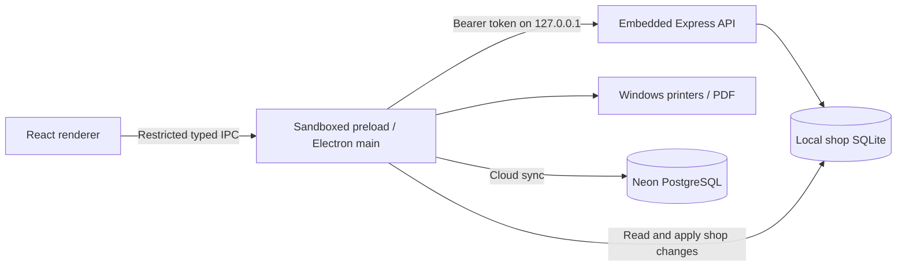

# Architecture

## Runtime boundaries

Each desktop runs its embedded API against its own SQLite shop database. Synchronize before switching computers. Concurrent local and cloud changes pause synchronization for reconciliation.

React handles navigation, forms, tables, charts and client query caching. It has no Node.js, filesystem, raw IPC, database credentials or access-token API. The preload exposes only the functions declared in `packages/shared/src/desktop.ts`.

Electron main validates IPC senders and schemas, stores credentials using Windows secure storage, manages synchronization, and controls file dialogs and printing. The shop database and checkout journal live under Electron's `userData` directory.

The backend verifies opaque session tokens against hashed entries in the shop database and obtains role/shop membership from `staff`. Passwords use salted scrypt hashes. Internal UUIDs and financial foreign keys remain unchanged. All business queries use the resulting shop ID. Database credentials stay in Electron main (Windows secure storage) and the embedded API; the renderer never receives them.

## Transactions

Financial and stock commands carry a UUID operation ID. The API checks the command kind and payload fingerprint, applies the changes in a transaction and records the result. Retrying an identical command returns that result.

The shop-level lock deliberately favors simple, deterministic consistency over maximum throughput. Batch row locks remain explicit. This is suitable for a small retail shop; larger deployments should benchmark throughput before introducing finer lock granularity.

Amounts use integer LKR cents; quantities use integer thousandths; tax rates use basis points. Multiplication and apportionment use BigInt intermediates. Product price, tax and cost are snapshotted when a sale is accepted. The desktop uses the local shop catalog while offline.

## Domain modules

- Catalog: categories, contacts, products, dynamic attributes, conversion metadata, CSV import and private images.
- Inventory: orders/receiving, immutable movements, FEFO batches, adjustments, stocktakes and supplier returns.
- Sales: checkout, external payment references, credit, parked carts and partial/full returns.
- Finance: invoice repayment allocations, customer/supplier ledgers, expenses and cash sessions.
- Reporting: business-date aggregates, current balances/stock, exports, notifications and audit activity.
- Legacy receipt sync API: terminal authorization, expiring grants, durable incoming receipts and explicit conflict reconciliation.
- Drivers and credit: factories, lorry drivers, quick credit records, per-invoice installment schedules, installment-level repayment allocation and the due list (`modules/drivers`, `modules/credit`).
- Daily business: one `businessSummary` (`modules/reporting/daily.ts`) feeds the dashboard, Daily business page, end-of-day print and reports, so figures always agree.

Credit, schedule, allocation and discount arithmetic lives in `packages/shared/src/credit.ts` and is used by both the renderer previews and the server.

`app.ts` binds HTTP routes to these modules. Errors share an envelope and request ID. Tests use the same services and migrations as production. The E2E Auth fixture lives exclusively in `scripts/test-server.ts` and is not bundled into the server.

## External integrations

Physical card and bank payments are recorded with confirmation references. Product images synchronize with shop data.
